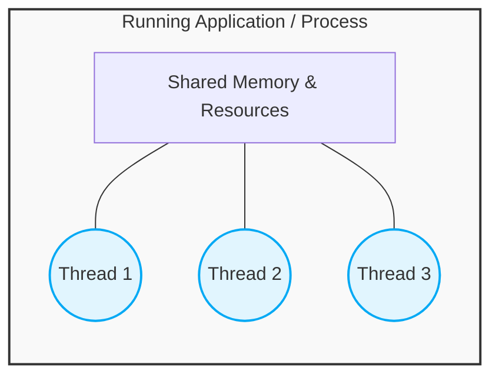

Have you ever wondered how your web browser lets you download a large file, stream a YouTube video, and scroll through a webpage all at the exact same time? Or how a video game can render complex graphics while simultaneously playing background music and listening to your controller inputs?

The secret sauce behind this multitasking magic is **Multithreading**. 

If you are starting your journey as a Java developer, multithreading might sound like an intimidating, complex beast. But don't worry! In this guide, we are going to break down the core concepts, understand exactly *why* we need it, and learn how to write your very first multithreaded Java program.

---

## The Core Concepts: Process vs. Thread

Before we jump into Java code, we need to understand the environment our code runs in. Let's define the two most important terms in concurrent programming:

### What Is a Process?
Think of a **Process** as an application that is currently running on your computer. When you open Google Chrome, you start a process. When you open IntelliJ IDEA, you start another process.
*   **Heavyweight:** Processes consume a lot of memory and system resources.
*   **Isolated:** Each process has its own separate memory space. If one process crashes, it generally doesn't bring down other processes.

### What Is a Thread?
A **Thread** is a smaller unit of execution *inside* a process. It is a single path of execution within a program.
*   **Lightweight:** Threads are much lighter than processes.
*   **Shared Memory:** All threads within the same process share the same memory and resources. This makes communication between threads fast, but it also means one misbehaving thread can crash the whole process!

### Visualizing the Architecture

Here is a simple diagram to illustrate how threads live inside a process. 


*(Diagram: Multiple lightweight threads sharing the resources of a single heavyweight process.)*

---

## Why Do We Need Multithreading?

Imagine you are running a restaurant. 

**Without Multithreading (Single-threaded):** You have exactly one employee. This person has to take the customer's order, walk to the kitchen, cook the food, serve it, and then wash the dishes before they can even look at the next customer. The queue out the door would be massive!

**With Multithreading:** You hire specific people for specific jobs. You have a waiter (Thread 1) taking orders, a chef (Thread 2) cooking, and a busboy (Thread 3) cleaning. The restaurant runs smoothly and efficiently.

In software, we use multithreading for:
1.  **Responsiveness:** If your app is doing heavy calculations on the main thread, the user interface (UI) will freeze. Moving that calculation to a background thread keeps the UI snappy.
2.  **Resource Utilization:** Modern CPUs have multiple cores. A single-threaded application only uses one core, leaving the others idle. Multithreading puts your whole CPU to work!
3.  **Simultaneous Operations:** A web server needs to handle thousands of users at once. It spawns a new thread (or uses a thread pool) for every incoming user request.

---

## How to Achieve Basic Multithreading in Java

Java was built with multithreading baked right in from day one. There are two primary ways to create a thread in Java:

### Method A: Extending the `Thread` Class

The simplest way is to create a class that inherits from `java.lang.Thread` and override its `run()` method.

```java
// 1. Create a class that extends Thread
class MyFirstThread extends Thread {
    
    // 2. Override the run() method. This is the code the thread will execute!
    @Override
    public void run() {
        for (int i = 1; i <= 5; i++) {
            System.out.println(Thread.currentThread().getName() + " is running: " + i);
            try {
                // Pause the thread for 500 milliseconds to simulate work
                Thread.sleep(500); 
            } catch (InterruptedException e) {
                System.out.println("Thread interrupted!");
            }
        }
    }
}

public class MainApp {
    public static void main(String[] args) {
        // 3. Instantiate your thread
        MyFirstThread threadA = new MyFirstThread();
        threadA.setName("Worker-A");

        // 4. Start the thread! 
        // NOTE: Call start(), NEVER call run() directly!
        threadA.start(); 
        
        System.out.println("Main thread is finished, but Worker-A is still going!");
    }
}
```

### Method B: Implementing the `Runnable` Interface (Recommended)

In Java, a class can only extend *one* parent class. If your class already extends something else (like an Applet or a UI component), you can't extend `Thread`. 

Instead, you can implement the `Runnable` interface. This is considered the best practice by most Java engineers.

```java
// 1. Implement the Runnable interface
class MyRunnableTask implements Runnable {
    
    @Override
    public void run() {
        for (int i = 1; i <= 3; i++) {
            System.out.println("Runnable Task executing step " + i);
        }
    }
}

public class RunnableApp {
    public static void main(String[] args) {
        // 2. Create an instance of your Runnable class
        MyRunnableTask myTask = new MyRunnableTask();
        
        // 3. Pass the Runnable object into a new Thread object
        Thread workerThread = new Thread(myTask);
        
        // 4. Start the thread
        workerThread.start();
    }
}
```

### ⚠️ The Golden Rule: `start()` vs `run()`
A common beginner mistake is calling `threadA.run()` instead of `threadA.start()`. 
*   If you call `run()`, it just executes the code like a normal method on the *current* thread. No new thread is created.
*   If you call `start()`, Java does the heavy lifting behind the scenes to talk to the operating system, spin up a brand new thread, and *then* that new thread executes the `run()` method.

---

## Wrapping Up

Multithreading is a powerful tool in your Java toolbelt. While we've only scratched the surface today, understanding the difference between a process and a thread, and knowing how to implement `Runnable`, gives you the perfect foundation.

As you advance, you'll learn about thread synchronization, preventing race conditions, and using Java's modern `ExecutorService`. But for now, try copying the code above into your IDE and experiment with starting multiple threads at once! 

Happy Coding! ☕